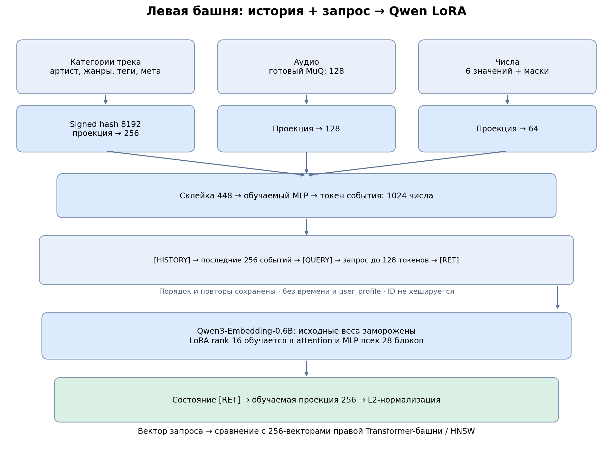
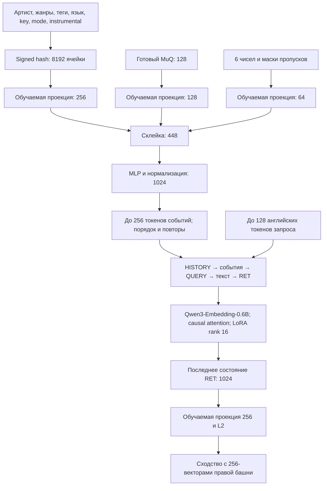

# Две башни: Qwen LoRA + Transformer треков

Запуск: `python tools/train_qwen.py`; инференс: `python tools/predict_qwen.py`.
Параметры G4 и текущая политика продолжения описаны в [README](../README.md) и
[Colab runner](colab_training.md). Ниже — устройство зафиксированного ядра.

## Архитектура





Хешируется полное имя, например `genre=rock`, с весом `1/число значений поля`.
Значения уникализируются внутри поля. Алгоритм стабилен между процессами:
BLAKE2b, 8 байт, seed, отдельные биты индекса и знака. Коллизии возможны;
семантику учат проекции и башни. Track ID служит только соединению таблиц.
Title/lyrics есть у правой башни, но не в токене события левой.

Хеш хранится как индексы/веса ненулевых ячеек. `EmbeddingBag(sum)` с весами
равен линейной проекции разреженного хеша; промежуточный тензор
`batch × 256 × 8192` и все векторы его ячеек не создаются. Числа: прежние
6 полей, median/IQR, clip ±5, 6 масок; дополнительно два флага наличия
MuQ/категорий. Этот блок преобразуется в 64 числа.

HISTORY, QUERY, RET — отдельная таблица трёх обучаемых векторов, вставляемая
через `inputs_embeds`. Обычная таблица embeddings и словарь Qwen заморожены.
RET инициализируется pretrained EOS. Qwen загружается через AutoModel без
lm_head; use_cache=False. Через замороженные веса идёт градиент к входным
проекциям и LoRA — no_grad вокруг Qwen нет. Gradient checkpointing:
use_reentrant=False. Soft-токены масштабируются под исходные embeddings.

Полностью обучаются проекции истории, новые маркеры и выходная проекция.
LoRA rank16/alpha32 в q/k/v/o_proj и gate/up/down_proj всех 28 блоков Qwen.
Исходные веса и нормы Qwen заморожены. Правая
[Transformer-башня](track_tower_transformer.md) обучается с первого шага:
5 токенов ×128, 2 слоя, 4 heads, FFN512, masked mean, 256 и L2.

Берём последние 256 событий до фильтрации неизвестных ID, затем такие ID
пропускаем. Сохраняем порядок и повторы; не используем время и user_profile.
Пустая история допустима технически, но отдельно не обучалась. Полная
последовательность — до 387 позиций; RET не обрезается, padding не пулируется.

## Обучение и ограничения

Только английский Music4All-CRS, без переводов. Запросы/разметка соединяются по
query_id. Истории проверяются на порядок и отсутствие событий после начала
train-окна 2020-01-21 00:00 UTC. Будущие timestamps, прослушивания и популярность
не подаются в башни. Препроцессинг использует известный каталог без query labels.
MiniLM фиксирован и кодирует только карточки/lyrics правой башни.

Sampled softmax: 1024 общих равномерных IID сэмпла с возвращением на мини-батч,
Q=1/N. Из логитов отрицательных вычитаем log(K/N); положительный включён точно
с expected count=1. Повторные сэмплы сохраняют кратность. Случайные совпадения
с целевой записью, включая aliases Spotify, маскируются. Это приближение
full softmax; отрицательный сэмпл не означает дизлайк. На инференсе logQ нет.

Micro-batch4, накопление8 (обычно 32 запроса/обновление); LR LoRA1e-4,
новые веса3e-4, AdamW, temperature0.08, clipping1. Это начальные настройки,
а не измеренный оптимум. Без 4-bit: BF16 при поддержке GPU, иначе FP16 и
GradScaler. Overflow снижает scale и повторяет те же примеры без пропуска
обновления. Эта копия ядра проверена на BF16 G4; настройки других GPU требуют отдельного smoke. Короткий замер делает 5 обновлений, затем восстанавливает веса,
optimizer/RNG; при OOM уменьшает micro-batch. Оценка эпохи не включает
валидацию/подготовку/экспорт. Полная скорость на L4 не измерена.

Лимит — 24 часа активных запусков с подготовкой, резерв15 минут после train.
Кэш и учёт времени сохраняются между запусками. Граница проверяется между
блоками; текущий блок может закончиться позже. Это не учёт оплаты или простоя
между запусками и не выключение DataSphere: остановите платную конфигурацию
в интерфейсе после завершения. Gemma и другие процессы код не останавливает.

## Метрики

10% пользователей полностью отложены. Фиксированная регулярная проверка:
до 200 запросов на тип с новыми/знакомыми целями, где доступны. Ранжируем весь
каталог по сходству башен, без fusion, внешнего ранкера и LLM.

1. Удаляем неизвестные ID и дубли: один spotify_id — одна запись; без него
   уникальность по m4a_id. Целевая запись тоже сравнивается по этому ключу.
2. Для similar_to исключаем X, его aliases и артиста X.
3. Ranking: 1/log2(rank+1), если цель после очистки в топ-20, иначе0.
4. Discovery: только для целей, отсутствующих во **всей** прошлой истории;
   сначала убираем прослушанные записи, затем считаем nDCG@20.
5. Среднее внутри типа, затем равные веса типов. Если для какого-то типа нет
   применимых Discovery примеров, полный macro недоступен; показываем покрытие
   типов. Пропуск не заменяется нулём. Это нужно сверить с официальным кодом
   после его публикации.

Лучший checkpoint — macro-Ranking. Последнее определение организаторов
заменяет прежние 32 кластера/Href и веса Fast score. **Diversity не заменяется
самодельной формулой**: macro_diversity=None, status=not_available. Интерфейс
плагина: `data.scorer.diversity(top10_ids, query_type) -> float in [0,1]`.
Передавайте официальный оценщик с теми же MuQ, когда он будет доступен.
Итоговые коэффициенты и LLM-метрики пока не подключены. Отдельного MLP baseline нет.
Ranking/Discovery проверены по переданному описанию; сверки с официальным кодом нет.

## Чекпоинты и инференс

last.pt содержит обучаемые параметры Qwen, правую башню, optimizer/scaler,
эпоху/позицию и RNG. Frozen Qwen остаётся в HF-кэше. Resume восстанавливает
порядок, случайные отрицательные и dropout. Сохраняем каждые100 шагов,
оцениваем каждые1000 и в конце эпохи. Прерывание внутри обновления откатывает
к последнему целому checkpoint. Изменение данных/архитектуры/кода создаёт новый run.

Bundle: две башни, pinned ссылка на Qwen, tokenizer, preprocessing, хеш-признаки,
ID, нормированные 256-векторы и HNSW. SHA256 проверяет согласованность файлов;
экспорт идёт через временную папку. Данные, веса и кэш не коммитятся.

```python
from recsys.two_tower_qwen.bundle import QwenRetriever

retriever = QwenRetriever("/path/to/bundle", device="cuda", cache_dir="/path/to/hf-cache")
vector = retriever.encode_query("Energetic rock for running", history=["m4a_id_1", "m4a_id_2"])
results = retriever.search("Energetic rock for running", history=["m4a_id_1"], k=100)
```

Держите один retriever в памяти. Отправляйте вектор в удалённый API только
после установки **индекса этого bundle**. Старый сервер не обновлялся.
search возвращает ANN-кандидатов; дедупликация, прикладные ограничения и ранкер
добавляются следующим этапом. encode_item_features принимает признаки нового
трека из тех же fixed MiniLM/MuQ и сохранённого TrackPreprocessor.

## Проверка

`python -m pytest -q tests` проверяет градиенты, маски, loss, метрики,
resume/RNG и экспорт на маленьком Qwen3. `python tools/verify_training_code.py`
сверяет SHA256 с текущим обучением. CPU-проверки не подтверждают качество музыки
и официальную Diversity. Текущая политика checkpoint/early stopping/топ-200
находится вне подписанного ядра — в `jobs/colab_continue/`.
