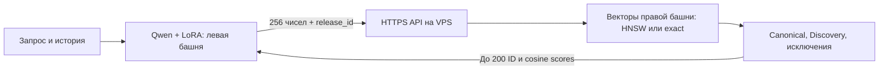

# Левая башня и API правой башни на VPS

Ветка `codex/qwen-vps-api` разделяет **инференс** обученной пары. Ядро обучения, формат checkpoint и веса сохранены.



Правая башня кодирует весь каталог при `export_bundle()`. Онлайн VPS обслуживает поиск по **готовым нормированным векторам, каталогу и HNSW**. PyTorch, Qwen, CUDA и query adapter на VPS не устанавливаются. Сервис не кодирует сырой текст запроса и не переобучает модель.

Левая башня хранит Qwen/LoRA, проекции истории, tokenizer и признаки треков истории. Она не загружает item tower, матрицу векторов или HNSW. Frozen Qwen скачивается с закреплённой revision; base cache можно заранее подготовить. На CPU энкодер использует FP32, на совместимой CUDA — BF16, иначе FP16. Serving заново токенизирует исходный текст и не использует проблемный обучающий token cache.

## Подготовка артефактов

Исходный bundle — каталог `exports/<bundle_id>/` с `manifest.json` и всеми файлами. Текущий лучший экспорт: **step 104000**, `ff8b638238b7d735-step-104000-10201043c808` (6,501 эпохи). Последний checkpoint для продолжения обучения: step 109289 / 6,832 эпохи. Веса не размещаются в Git.

```bash
python tools/split_serving_bundle.py \
  --bundle /data/training/exports/ff8b638238b7d735-step-104000-10201043c808 \
  --output /data/serving/step-104000
```

Проверяются SHA256 **всех** исходных файлов; новый каталог создаётся атомарно. Существующий output не перезаписывается.

| Часть | Содержимое | Размещение |
|---|---|---|
| `left/` | query weights, config, tokenizer, catalog, history features | хост левой башни |
| `right/` | catalog, `track_vectors.npy`, `tracks.hnsw` | CPU VPS |

Обе части содержат `source_manifest.json` и `serving_manifest.json`. `release_id` — SHA256 канонического полного source manifest; он учитывает обе башни, preprocessing, history features, каталог и индекс. Совпадения имени модели или размерности недостаточно для совместимости.

## Запуск VPS через Docker

Нужны Docker Engine и Compose v2. Скопируйте `right/` на VPS. OAuth и Google Drive credentials контейнеру не нужны. Выполняйте из корня checkout этой ветки:

```bash
mkdir -p deploy/right-tower/secrets
(umask 077; openssl rand -hex 32 > deploy/right-tower/secrets/qwen_api_key)
sudo chown 10001:10001 deploy/right-tower/secrets/qwen_api_key
sudo chmod 0400 deploy/right-tower/secrets/qwen_api_key
export QWEN_RIGHT_BUNDLE_HOST=/srv/qwen/step-104000/right
docker compose -f deploy/right-tower/compose.yaml up -d --build right-tower
curl --fail http://127.0.0.1:8000/health
```

Bundle должен быть читаем UID 10001. Секретный файл принадлежит тому же UID: Compose file secrets монтируются как файлы хоста. API запускается без root, с read-only filesystem/bundle. Лимиты контейнера: 2 CPU, 1 GiB RAM, один worker и до 8 соединений. Эти настройки — начальный лимит, а не гарантия throughput конкретной VPS. Индекс загружается до readiness через [FastAPI lifespan](https://fastapi.tiangolo.com/advanced/events/); `ef=1024` фиксируется после startup и не изменяется запросами.

Порт 8000 доступен только на `127.0.0.1`. Для внешнего доступа подготовьте DNS домена и разрешите входящие 80/443:

```bash
export QWEN_DOMAIN=candidates.example.com
docker compose -f deploy/right-tower/compose.yaml --profile tls up -d --build
```

Caddy завершает TLS и проксирует API. Клиент передаёт ключ в `X-API-Key`. Альтернатива — приватная сеть/SSH tunnel. Публичный HTTP с ключом не используйте.

Без Docker:

```bash
python -m venv .venv-api
. .venv-api/bin/activate
HNSWLIB_NO_NATIVE=1 pip install -r requirements-serving.txt
export QWEN_RIGHT_BUNDLE=/srv/qwen/step-104000/right
export QWEN_API_KEY_FILE=/private/qwen_api_key
OPENBLAS_NUM_THREADS=1 OMP_NUM_THREADS=1 \
  python -m uvicorn recsys.serving.app:create_env_app --factory \
  --host 127.0.0.1 --port 8000 --workers 1 --limit-concurrency 8
```

## Подключение левой башни

Установите PyTorch под нужную CUDA/CPU и зависимости на хосте энкодера:

```bash
pip install -r requirements.txt -r requirements-serving-client.txt
export QWEN_RIGHT_URL=https://candidates.example.com
python tools/predict_qwen.py \
  --bundle /data/serving/step-104000/left \
  --api-key-file /private/qwen_api_key \
  --query 'Energetic rock for running' \
  --history /data/past_history.json --top-k 200 --device cuda
```

Remote CLI получает именно `left/`. Ключ также можно передать в `QWEN_API_KEY`; не пишите его в аргументах или Git. `--exact`, `--discovery`, `--query-type similar_to`, `--exclude-m4a-id`, `--exclude-artist` работают через API. Без API URL прежний локальный CLI работает с полным исходным bundle.

```python
import os
from recsys.serving.client import RemoteQwenRetriever

with RemoteQwenRetriever.from_bundle(
    '/data/serving/step-104000/left',
    url=os.environ['QWEN_RIGHT_URL'],
    api_key=os.environ['QWEN_API_KEY'],
    device='cuda', cache_dir='/data/hf_cache', timeout=10,
) as retriever:
    result = retriever.search(
        'Energetic rock for running',
        history=['track1', 'track2'],  # хронологически, с повторами
        k=200, discovery=True, exclude_ids=['banned-track'],
    )
    ids, scores = result['ids'], result['scores']
```

Для long-lived приложения создайте retriever на startup и вызовите `close()` при shutdown. Проверка `/health` выполняется **до** загрузки Qwen. Каждый поисковый запрос и ответ дополнительно проверяют релиз. Timeout/HTTP error/mismatch вызывают `CandidateAPIError`; fallback на другой кандген должен явно обрабатывать его в вызывающем приложении. Скрытых retry и redirect с ключом нет.

Энкодер использует оригинальный `encode_query()` обученной модели. Для кодирования берутся последние 256 событий истории; **полная** переданная история отправляется в API для Discovery. Не обрезайте её до 256 событий, если нужно исключать все ранее прослушанные треки.

## Контракт API v1

`GET /health` — readiness: `status`, `api_version`, `bundle_id`, `release_id`, `dimension=256`, `n_items`, `device=cpu`, `ef`. `GET /live` — liveness. Эти пути доступны без ключа; поиск и OpenAPI schema требуют ключ.

`POST /v1/search`, заголовок `X-API-Key`:

| Поле | Контракт |
|---|---|
| `bundle_id`, `release_id` | оба обязательны, из `serving_manifest.json` |
| `vector` | 256 конечных чисел, L2-нормировка с допуском 0,5% |
| `k` | 1..200, по умолчанию 200 |
| `mode` | `hnsw` или `exact` |
| `history` | полная хронологическая история `m4a_id`, по умолчанию `[]` |
| `discovery` | boolean, по умолчанию false |
| `query_type` | по умолчанию `exact`; `similar_to` включает reference/artist exclusions |
| `exclude_m4a_id`, `exclude_artist` | по умолчанию пустые строки |
| `exclude_ids` | запрет canonical-групп перечисленных `m4a_id`, по умолчанию `[]` |

History/exclude IDs — до 100 000 строк каждая, ID до 128 символов; HTTP body до 4 MiB. Лишние поля, NaN/Inf, boolean/string вместо чисел отвергаются. Сервер нормирует небольшой численный дрейф вектора.

Ответ: `bundle_id`, `release_id`, `mode`, `returned`, `ids`, `scores`, `candidates=[{m4a_id, score}]`, `elapsed_ms`. Scores — cosine similarity по убыванию. Spotify aliases объединяются; ID exclusions убирают целую canonical-группу; similar_to убирает reference-группу и заданного исполнителя без учёта регистра. Discovery исключает canonical-группы всей истории. ANN добирает кандидатов после фильтрации. При недостатке допустимых треков возвращается меньше `k`, без padding и дубликатов.

| HTTP | Причина |
|---|---|
| 401 | отсутствующий/неверный API key |
| 409 | энкодер и индекс разных релизов |
| 413 | body превышает 4 MiB |
| 422 | контракт или невалидный/ненормированный вектор |
| 503 | перегрузка ограниченного Uvicorn worker |

При повреждении SHA/shape/нормировки/индекса startup завершается ошибкой. Клиент ограничивает ответ 1 MiB и проверяет структуру, число/порядок кандидатов и identity ответа.

## Проверки и обновление модели

```bash
pip install -r requirements-dev.txt
USE_TF=0 HF_HUB_OFFLINE=1 python -m pytest -q tests
python tools/verify_training_code.py
python tools/smoke_candidate_api.py --right /data/serving/step-104000/right \
  --url https://candidates.example.com --api-key-file /private/qwen_api_key
```

Smoke сверяет exact выдачу с локальной матрицей, проверяет HNSW, canonical-дедупликацию и Discovery. Сохранённые векторы треков используются как query-векторы; это проверка API/индекса, **не** новый замер Recall. CPU tests проверяют tiny Qwen, веса левой башни, фильтры относительно прежнего scorer, ошибки сети и mismatch. CI собирает Docker image и проверяет HTTP к контейнеру без PyTorch.

При смене каталога/весов разделите **новую согласованную пару**; перезапустите right и загрузите соответствующий left. Во время mismatch поиск блокируется 409. Сохраните старую пару для rollback. Каталог неизменяемый: raw metadata ingestion, online обучение и независимое добавление произвольных векторов не входят в API v1. Для нового каталога нужен переэкспорт с прежними MiniLM/MuQ/history признаками и согласованной query tower.
