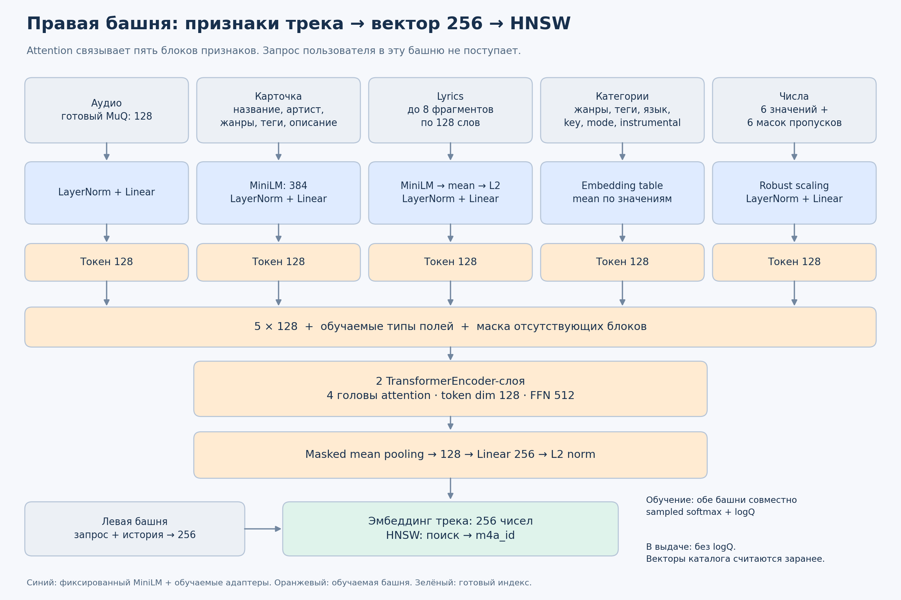
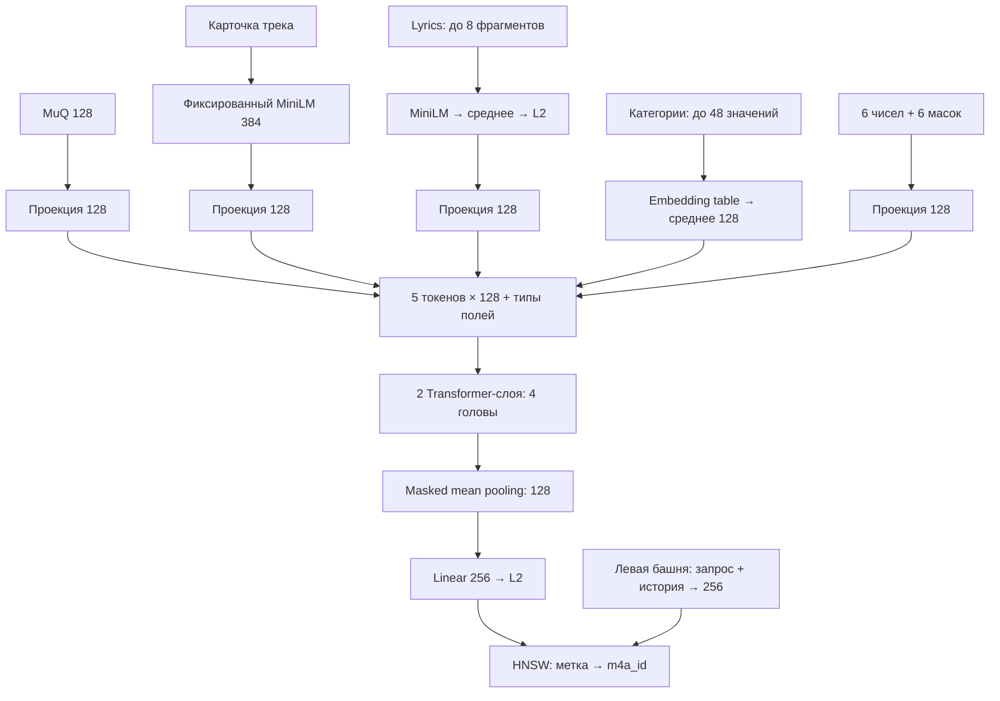

# Transformer для правой башни

Реализация — `recsys/track_tower.py`. Эксперимент обучает обе башни совместно;
правая получает только признаки трека, левая — запрос и прошлую историю пользователя.
HNSW строится после обучения по выходным векторам правой башни. Сам индекс не обучается
градиентами и не заменяет башню.



## Вход и преобразования

| Блок | Исходные данные | Токен |
|---|---|---|
| Audio | готовый `muq_embedding`, 128 чисел, L2-нормированный | LayerNorm + Linear → 128 |
| Card | название, артист, жанры, теги, `pseudo_caption` | фиксированный MiniLM 384 → LayerNorm + Linear → 128 |
| Lyrics | до 8 перекрывающихся фрагментов по 128 слов | фиксированный MiniLM для каждого фрагмента → среднее + L2 → Linear → 128 |
| Categories | жанры, теги, `lang`, `key`, `mode`, `is_instrumental` | словарь + обучаемая таблица → среднее по непустым значениям → 128 |
| Numbers | energy, valence, danceability, tempo, duration, year | 6 scaled values + 6 масок наличия → LayerNorm + Linear → 128 |

Для lyrics перед Linear также используется LayerNorm. Нулевой tempo считается пропуском,
нулевая energy — реальным значением. Длительность преобразуется через log1p; числовые
значения масштабируются по медиане и IQR каталога, ограничиваются диапазоном ±5.
Категории имеют префикс поля: один и тот же `rock` в жанре и теге — разные значения.
PAD=0, UNK=1. Hashing trick здесь не используется: словарь каталога помещается в память.
Ключ трека служит только для соединения таблиц и сопоставления меток HNSW.

К токенам добавляются обучаемые обозначения типа поля. Пустые блоки маскируются
в attention и pooling. Два pre-norm TransformerEncoder-слоя имеют 4 головы,
размер токена 128, FFN 512 и dropout 0.1. Masked mean pooling даёт 128 чисел,
последняя проекция — 256; выход нормируется по L2. Позиционные embeddings не нужны:
тип каждого поля задан отдельно, а набор категорий не упорядочен.



## Запуск обучения

Положить `two_tower_transformer_l4.ipynb` рядом с папкой `conversational-recsys/`.
Вторая ячейка задаёт `REPO_DIR`, `DATA_DIR` и внешний `ARTIFACT_DIR`.
Файлы данных: `train.parquet`, `train_queries.parquet`, `train_qrels.parquet`,
`tracks_meta.parquet`, `track_embeddings.parquet` с MuQ (или MuQ внутри tracks_meta).
Запустить ячейки сверху вниз на L4. Установка зависимостей включена по умолчанию;
после обновления уже импортированного PyTorch надо перезапустить ядро и выставить
`INSTALL_DEPENDENCIES=False`. Рекомендуемый runtime: PyTorch 2.7.1 cu118.

Быстрый эксперимент: `max_users=64`, `max_queries_per_user=8`, `epochs=2`.
Даже при ограничении пользователей кодируется весь каталог, чтобы оценивать поиск
по реальному набору кандидатов. Первое кодирование lyrics может занять существенное
время, затем используется возобновляемый кэш. По умолчанию обучение: batch=128,
1024 IID-негатива с возвращением, sampled softmax с logQ-коррекцией, 10 эпох.
Положительный трек включён точно; поправка log(KQ) применяется к негативам.
Для выдачи используется обычное скалярное произведение без logQ.

Внутренняя валидация отделяет 10% пользователей, history берётся только из past.
Early stopping и выбор checkpoint используют nDCG@20. Для окончательной оценки
нужен отдельный следующий месяц `test_public`; маленький CPU-прогон — проверка
работоспособности, а не оценка качества рекомендации. Валидационный notebook
не выполняет финальный refit по всем пользователям автоматически.

## Экспорт и использование

Внешний bundle содержит обе TorchScript-башни, preprocessing и текстовый encoder,
`track_vectors.npy`, `tracks.hnsw`, `tracks.parquet` и клиентские модули.
`serving.py` реализует точный поиск; пример загрузки и запроса HNSW находится
в последних ячейках ноутбука. `track_encoder.py` принимает метаданные нового трека
и его готовый MuQ-вектор. Обработка новых треков использует те же функции и
статистику, что обучение. Извлечение MuQ из raw audio в этот модуль не входит.

В онлайн-поиске правую башню для всего каталога повторно запускать не требуется:
левая вычисляет вектор запроса, HNSW ищет среди заранее посчитанных 256-векторов.
Для нового трека надо вычислить вектор и добавить уникальную метку в HNSW,
обновить каталог соответствий и при необходимости увеличить capacity индекса.
После переобучения правой башни все векторы каталога и индекс пересчитываются.

Это новое пространство: существующий индекс EmbeddingGemma и старую левую башню
нельзя использовать с этими векторами. Обновляйте обе башни и индекс одним bundle.
Текущий публичный API, pipeline и процессы Gemma этот эксперимент не меняет.

## Проверка модуля

```bash
python -m unittest discover -s tests -p test_track_tower.py -v
```

Проверяются пропуски, числовые нули, неизвестные категории, независимость от порядка
категорий и состава batch, градиенты обеих башен, сохранение и загрузка TorchScript
с другими размерами batch и масками. Notebook дополнительно проверяет совпадение
экспорта с исходными башнями, кодирование новых записей и HNSW относительно exact.
